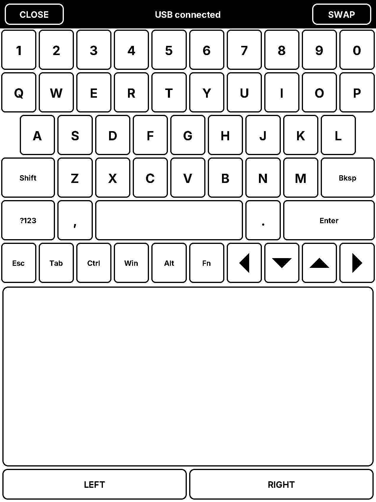
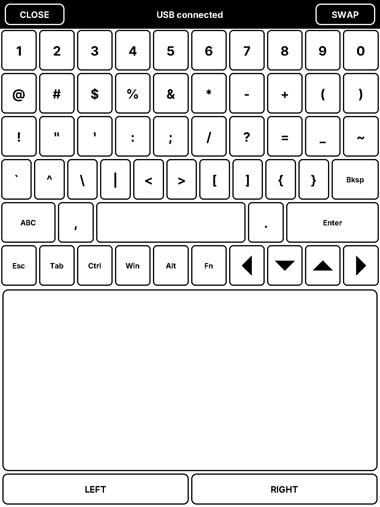
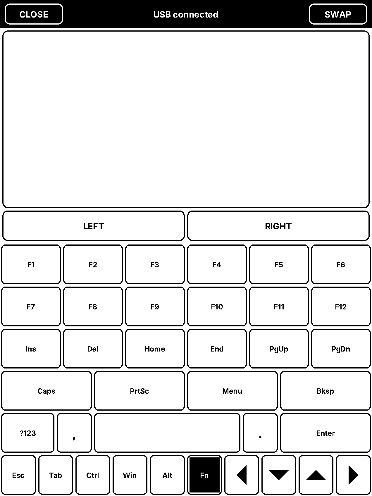
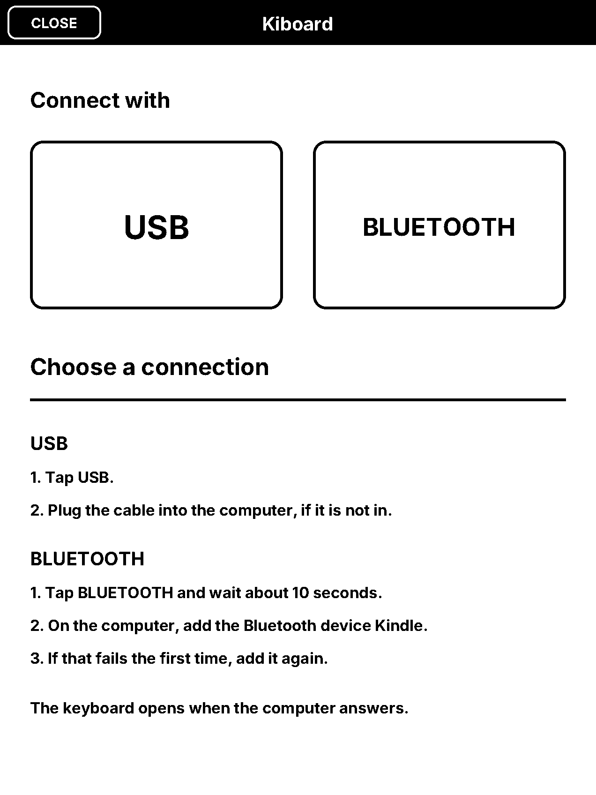

# Kiboard

Turns a jailbroken Kindle into a keyboard and trackpad for a computer, over USB or Bluetooth.
The computer sees a standard keyboard and mouse: no driver, no program to install on it.

  
  
  

- **Phone keyboard, PC keys.** Letters and symbols laid out as on a phone, plus Esc, Tab, Ctrl, Win, Alt,
  arrows, F1-F12 and the navigation keys.
- **Trackpad.** Move, tap to click, two fingers to right-click and scroll, drag.
- **USB or Bluetooth.** One tap for each. A paired computer connects in about 10 seconds.
- **Made for e-ink.** Black and white, no animation, only the touched key is redrawn.
- **Leaves the Kindle as it was.** Nothing is written to the system partition; closing the app restores
  the USB port and Bluetooth.

Built for and tested on one device: Kindle Paperwhite 12, firmware 5.19.6 (see [Limits](#limits)).
`KINDLE-DEV.md` holds the device facts this project relies on.

## Install

The Kindle must be jailbroken and able to run scriptlets (`.sh` files in the library).

1. Connect the Kindle to the computer with the cable.
2. Copy the contents of `dist/` to the Kindle drive: `Kiboard/` and `documents/Kiboard.sh`.
3. Eject the drive. Kiboard is now in the library.

## Use

Close KindleSSH's screen first if it is open (it holds the touch screen; its server stays on).
Tap Kiboard in the library, then choose:

**USB.** Tap USB. Plug the cable into the computer if it is not in. The Kindle's drive leaves the computer
at that moment, so finish file copies first.

**Bluetooth.** Tap BLUETOOTH and wait about 10 seconds. On the computer add the Bluetooth device "Kindle"
(on Windows also: `bt\pair.ps1`, and `bt\pair.ps1 -Unpair` to remove it). A computer that is already paired
connects by itself. If you removed the Kindle on the computer, the first new pairing fails: add it again.

The keyboard opens when the computer answers.

- Trackpad: 1 finger moves, 1-finger tap = left click, 2-finger tap = right click, 2-finger drag = scroll.
  Hold LEFT with one finger and move with another to drag.
- Keys go down with the finger and up with the finger, so the computer repeats a held key.
- The keys are laid out as on a phone, with a row of PC keys (Esc, Tab, Ctrl, Win, Alt, arrows) below.
  ?123 opens the symbols, where each key types the character on it. Fn opens F1-F12 and the navigation keys.
- Shift works as on a phone: a tap is for the next key; tap again to take it back.
- Ctrl, Alt, Win are keys like the others: a tap on Win opens the Windows menu, and a held one applies
  to the keys you press meanwhile. Held alone for half a second, it locks for the next key; touch it again to unlock.
- SWAP: keyboard and trackpad change places.
- Leave: CLOSE, the power key, or 10 minutes without a touch. The Kindle's USB port and Bluetooth are then
  as they were.
- Keys are sent as US key positions. The computer's keyboard layout decides the characters, so the symbols
  are right only when the computer is set to a US layout.

## Limits

- Tested on one device only: Paperwhite 12, firmware 5.19.6. On another Kindle the picture is stretched to
  the screen, and the touch screen and power key are found by what they can do, but none of that was tried.
- Bluetooth mode changes three instructions of the Kindle's Bluetooth library (`bt.sh` explains them: a copy
  in RAM; nothing on the system partition). It finds them by function name and code, so another firmware
  works when its library still has the same code there. If not, Bluetooth mode refuses to start.
- While Bluetooth mode waits for a computer, the Kindle accepts every pairing request without asking.
  Use it where you trust the people in radio range.
- While Bluetooth mode is on, the Kindle's own Bluetooth (audio) is restarted twice and may drop.
- No BIOS or boot-menu typing: the keyboard has no boot protocol.
- One connection per run: to change from USB to Bluetooth, close Kiboard and open it again.

## Build (WSL)

1. `bash bt/build.sh` builds the Bluetooth helper `out/kiboard-bt`. It needs the ACE headers and the
   Kindle's `libace_bt.so` in `~/kiboard-ref` (see the script). Skip it for a USB-only build.
2. `bash build.sh` runs the PC tests, writes screenshots to `shots/`, and builds `dist/`.
   It needs the KindleSSH build in `~/kssh-build` (compiler wrappers, FBInk, fonts).

| File | Role |
|---|---|
| `hid.c` | HID report descriptor and reports |
| `gesture.c` | Trackpad gestures |
| `ui.c` | Screens, key layout, touch handling |
| `preview.c` | PC tests and screenshots |
| `main.c` | Screen (FBInk), touch input, main loop |
| `usb.c`, `usb.sh` | USB HID through FunctionFS (the kernel has no HID gadget) |
| `bt.c`, `bt.sh` | Starts and stops Bluetooth mode and the helper |
| `bt/kbt.c` | The helper `kiboard-bt`: HID over GATT on the Kindle's own Bluetooth stack |
| `bt/pair.ps1`, `bt/adv.ps1`, `bt/snoop.py` | PC tools: pair from Windows, list advertisements, read a packet log |

## License

GPL-3.0-or-later (see `LICENSE`): the program links FBInk (GPL-3.0-or-later) and stb_truetype (public domain).
The font is Inter 4.1, SIL Open Font License 1.1. `kiboard-bt` links Amazon's `libace_bt.so` at run time on
the Kindle; that library is not part of this project and is not distributed with it.
